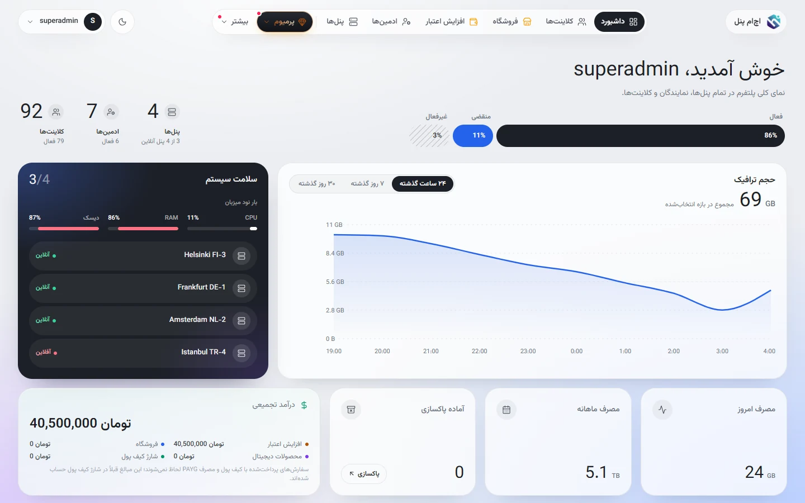
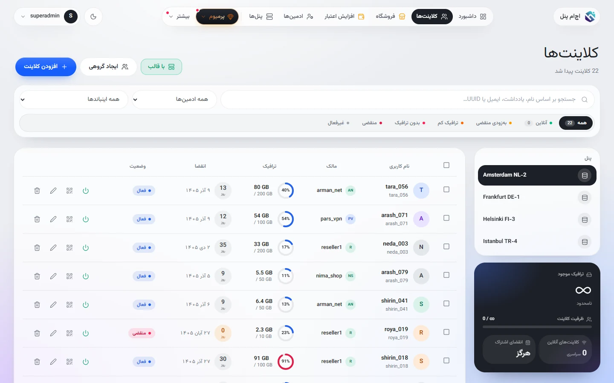
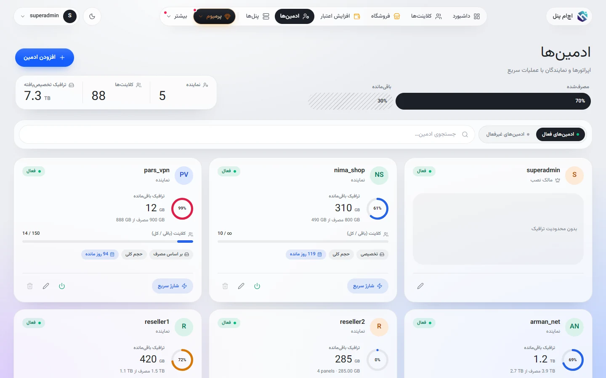
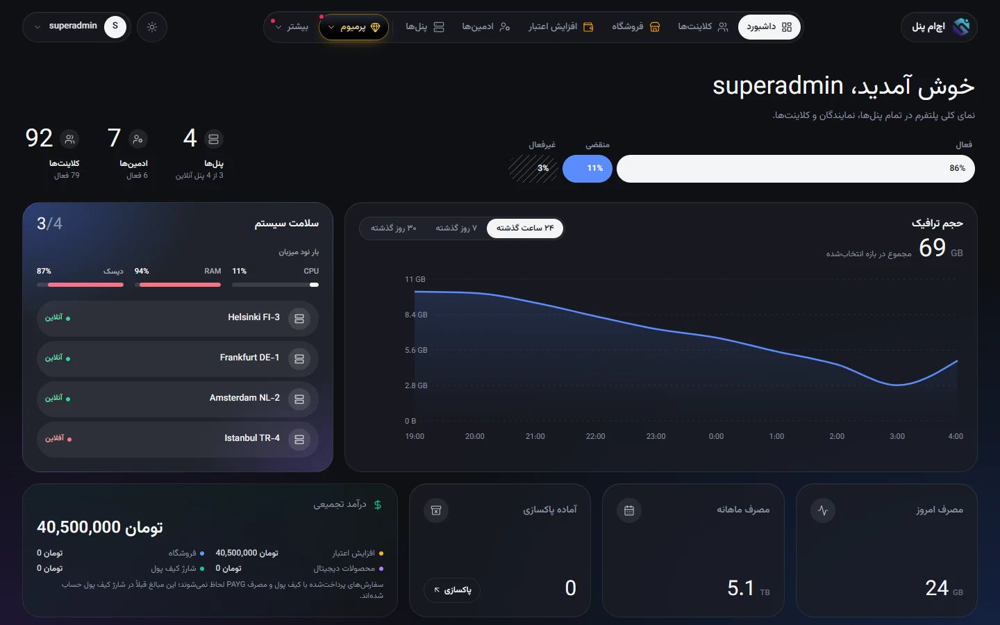
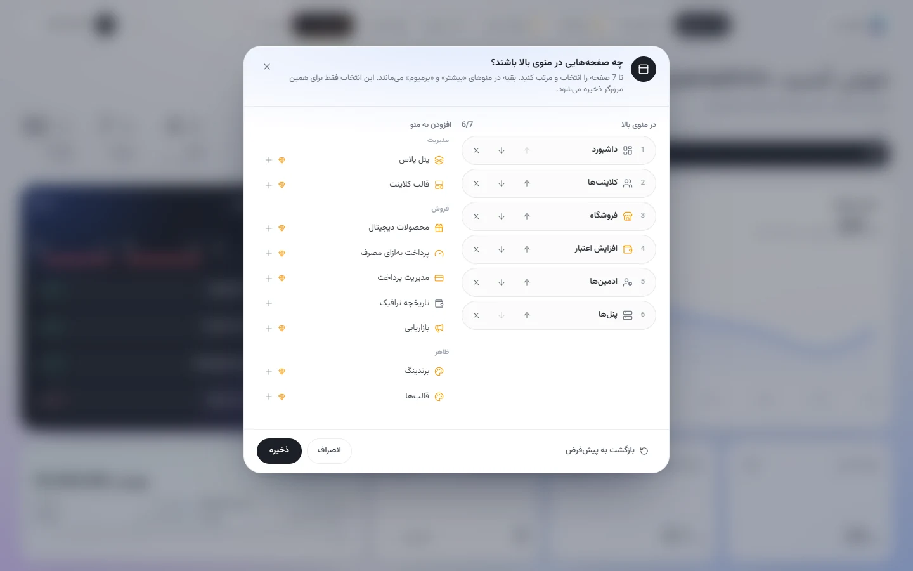

<div align="center">


<h1>HMray Panel</h1>

<p><b>Independent build</b> of <a href="https://github.com/neoauroraproject/hmpanel">HMPanel</a> (<a href="https://github.com/amir12120/hmray-panel">amir12120/hmray-panel</a>) — the project started from HMPanel v3.0.1 and is now developed here. See <a href="NOTICE.md">NOTICE.md</a> for provenance and <a href="LICENSE">LICENSE</a> for the terms.</p>

<p><b>پنل مدیریت حرفه‌ای 3x-ui برای نماینده‌ها و ارائه‌دهندگان VPN</b><br>
<sub>Advanced 3x-ui management platform for resellers and VPN providers</sub></p>

<p>
  <a href="https://github.com/amir12120/hmray-panel/releases/latest"></a>
  <a href="https://github.com/amir12120/hmray-panel/stargazers"></a>
  
  
</p>

<p>
  <a href="#نصب"></a>
  <a href="https://github.com/amir12120/hmray-panel/tree/main/docs"></a>
  <a href="https://t.me/hmpanel"></a>
</p>

<p>
</p>

<p><a href="#فارسی"><b>فارسی</b></a> &nbsp;·&nbsp; <a href="#english"><b>English</b></a></p>



</div>

---

<h2 id="فارسی">فارسی</h2>

<div dir="rtl">

اچ‌ام‌پنل (HMPanel) یک **لایه مدیریت حرفه‌ای روی 3x-ui اصلی** است، برای ارائه‌دهندگان VPN، نماینده‌ها و ادمین‌هایی که چندین سرور و تعداد زیادی کاربر دارند.

### ✨ تازه‌های نسخه ۳.۰.۱

- **اتصال به پنل‌های ثنایی از طریق پروکسی:** اگر سرور مستقیم به 3x-ui وصل نشود، درخواست‌ها از پروکسی SOCKS5 یا HTTP می‌روند؛ «فقط وقتی مستقیم نشد» یا «همیشه» (*تنظیمات ← عمومی*).
- **ظرفیت هر پنل:** حداکثر تعداد کلاینت؛ پنل پر کلاینت جدید نمی‌سازد و در فروش جدید نمایش داده نمی‌شود، ولی تمدید کار می‌کند.
- **گروه‌ها** در خود پنل هم ذخیره می‌شوند و فیلتر گروه به لیست کلاینت‌ها اضافه شد؛ گروه 3x-ui هم همگام می‌شود.
- **پیام روی لینک ساب**، **جزئیات بازطراحی‌شده کلاینت** (مصرف، انقضا، لینک‌ها و QR) و پنجره «چه چیزی جدید است» برای مدیر اصلی بعد از هر آپدیت.

### ✨ تازه‌های نسخه ۳

- **ظاهر مدرن جدید.** داشبورد، کلاینت‌ها، ادمین‌ها، پنل‌ها، ترافیک چیدمان و نمودارهای تازه دارند. منوی بالا یا کناری، روشن و تاریک. از ۳.۰.۱ ظاهر جدید با منوی کناری پیش‌فرض است و ظاهر کلاسیک هر وقت بخواهید برمی‌گردد (*تنظیمات ← ظاهر* یا از منوی حساب).
- **منوی بالای شخصی.** انتخاب کنید کدام صفحه‌ها (تا ۷ تا) و به چه ترتیبی در منوی بالا باشند (*منوی حساب ← شخصی‌سازی منوی بالا*).
- **ادمین‌ها:** ساخت ادمین مرحله‌به‌مرحله (نوع حجم کلی یا جدا برای هر پنل همان اول)، پنجره شارژ سریع برای حجم هر پنل، ظرفیت کاربر و روز، و تنظیم دسترسی ماژول‌ها از همان صفحه ادمین‌ها.
- **حذف کامل و تمیز:** حذف پنل حالا همه چیزهایی که نصب کرده را پاک می‌کند و نصب دوباره بدون خطا انجام می‌شود.

فهرست کامل: [CHANGELOG.md](CHANGELOG.md)

### 📸 تصاویر

<table>
  <tr>
    <td width="50%" align="center"><br><sub><b>کلاینت‌ها</b></sub></td>
    <td width="50%" align="center"><br><sub><b>ادمین‌ها</b></sub></td>
  </tr>
  <tr>
    <td width="50%" align="center"><br><sub><b>حالت تاریک</b></sub></td>
    <td width="50%" align="center"><br><sub><b>شخصی‌سازی منوی بالا</b></sub></td>
  </tr>
</table>

### ⚡ امکانات

**نسخه رایگان (Community)**
- **مدیریت چند پنل و نماینده:** کنترل چندین سرور 3x-ui، نماینده‌ها با محدودیت حجم، تعداد کاربر و زمان؛ حجم کلی یا جدا برای هر پنل.
- **حسابداری ترافیک:** محاسبه لحظه‌ای، حالت مصرفی و تخصیصی، مهلت قطع و لاگ امن استرداد.
- **یکپارچگی با 3x-ui:** اتصال کلاینت‌ها به گروه‌های اصلی 3x-ui و یک کلاینت روی چند اینباند. پشتیبانی تا نسخه 3.11.
- **گروه‌بندی و ظرفیت:** گروه کلاینت‌ها با فیلتر، و سقف تعداد کلاینت برای هر پنل.
- **اتصال از طریق پروکسی** به پنل‌هایی که مستقیم در دسترس نیستند (SOCKS5 یا HTTP).
- **عملیات گروهی و مهاجرت:** ساخت، ویرایش، تمدید و حذف گروهی؛ مهاجرت از پنل‌های قدیمی.
- **پشتیبان‌گیری:** دانلود، آپلود و بازگردانی بکاپ از پنل یا دستور `hm`.
- **ظاهر مدرن یا کلاسیک**، فارسی و انگلیسی، روشن و تاریک، قابل نصب به‌صورت اپ (PWA).

**نسخه پرمیوم**
- بخش‌های پرمیوم کدشان بخشی از این مخزن نیست و جداگانه و اختیاری ارائه می‌شوند.

> **بدون هیچ کلید لایسنس.** همه‌ی امکاناتی که در این مخزن هست — نصب، پنل و داشبورد،
> کلاینت‌ها و پنل‌ها، حسابداری ترافیک، CLI (`hm`)، آپدیتر، بکاپ، API و مستندات — با
> `RELEASE_MODE=COMMUNITY` (پیش‌فرض نصب) کامل کار می‌کند و رابط کاربری هیچ تبلیغ یا قفل
> پرمیومی نشان نمی‌دهد.

<a id="نصب"></a>

### 🚀 نصب

دستور زیر را در یک سرور اوبونتو (24.04+) یا دبیان تازه وارد کنید:

</div>

```bash
bash <(curl -fsSL https://raw.githubusercontent.com/amir12120/hmray-panel/main/install.sh)
```

<div dir="rtl">

*(پیش‌نیازها: آی‌پی پابلیک مستقیم برای SSL، حداقل ۱ گیگ رم و ۵ گیگ فضا)*

### 🔄 به‌روزرسانی

نصب‌های قبلی بدون نصب دوباره و بدون از دست رفتن اطلاعات به‌روز می‌شوند:

</div>

```bash
sudo hm update
```

<div dir="rtl">

یا `sudo hm` را بزنید و گزینه **Update** را انتخاب کنید.

### 💾 بکاپ و بازگردانی
- **از پنل:** *تنظیمات ← نگهداری سیستم* برای دانلود، آپلود یا بازگردانی بکاپ با یک کلیک.
- **از ترمینال:** دستور `sudo hm` و گزینه‌های بکاپ.

### 🗑️ حذف پنل

`sudo hm` را بزنید و **Uninstall** را انتخاب کنید، یا مستقیم:

</div>

```bash
sudo bash /opt/hmpanel/uninstall.sh --standard   # حذف برنامه، نگه‌داشتن دیتابیس، فایل‌ها، بکاپ‌ها و .env
sudo bash /opt/hmpanel/uninstall.sh --complete   # حذف همه چیز (باید DELETE را تایپ کنید)
```

<div dir="rtl">

هر دو حالت کانتینرها، سرویس systemd، دستور `hm` و فایل‌های موقت باقی‌مانده را پاک می‌کنند تا نصب بعدی تمیز انجام شود. بعد از حذف استاندارد، با اجرای دوباره نصب‌کننده اطلاعاتتان برمی‌گردد.

### 🔑 ریست رمز ادمین اصلی
اگر رمز ادمین اصلی (owner / SUPER_ADMIN) را فراموش کردید، روی سرور این دستور را بزنید:

</div>

```bash
bash <(curl -fsSL https://raw.githubusercontent.com/amir12120/hmray-panel/main/scripts/reset-admin-password.sh)
```

<div dir="rtl">

یا بعد از نصب/آپدیت: `sudo hm admin reset-password` · `sudo hm passwd` · گزینه **۱۳** منوی `hm`.

**نام کاربری** ادمین اصلی را هم فراموش کرده‌اید؟ دستور `sudo hm admin reset-login` (یا `sudo hm reset-login` یا گزینه **۱۴** منوی `hm`) نام کاربری فعلی ادمین اصلی را نشان می‌دهد و اجازه می‌دهد نام کاربری، رمز یا هر دو را عوض کنید (با Enter هر کدام بدون تغییر می‌ماند). رمز به‌صورت مخفی و دو بار پرسیده می‌شود (حداقل ۸ کاراکتر)، نام کاربری تکراری پذیرفته نمی‌شود و همه‌ی نشست‌های فعلی ادمین اصلی از حساب خارج می‌شوند. فهرست کامل دستورها: `sudo hm help`.

</div>

---

<h2 id="english">English</h2>

HMPanel is a **professional management layer built on top of native 3x-ui**, for VPN providers, resellers and administrators who run many servers and a large number of clients.

### ✨ What's new in v3.0.1

- **Reach 3x-ui panels through a proxy:** when this server cannot connect to a panel directly, requests go through a SOCKS5 or HTTP proxy, only when direct fails or always (*Settings → General*).
- **Panel capacity:** a maximum number of clients per panel; a full panel takes no new clients and is left out of new sales, while renewals keep working.
- **Groups** are also stored in the panel, with a group filter on the client list; the 3x-ui group still syncs.
- **Subscription message**, **redesigned client details** (usage, expiry, links and QR) and a one-time "What's new" window for the main admin after each update.

### ✨ What's new in v3

- **New modern look.** Dashboard, clients, admins, panels and traffic have new layouts and charts. Top bar or sidebar navigation, light and dark. Since 3.0.1 the new look with the side menu is the default; the classic look can be switched back at any time (*Settings → Appearance*, or from the account menu).
- **Your own top menu.** Pick which pages (up to 7) sit in the top bar and in what order (*account menu → Customize top menu*).
- **Admins:** step-by-step admin creation (shared or per-panel traffic is chosen first), a quick top-up dialog for per-panel GB, client capacity and days, and per-admin module access set on the Admins page.
- **Clean uninstall:** removing the panel now deletes everything it installed, so a reinstall works without errors.

Full list: [CHANGELOG.md](CHANGELOG.md).

### 📸 Screenshots

<table>
  <tr>
    <td width="50%" align="center"><br><sub><b>Clients</b></sub></td>
    <td width="50%" align="center"><br><sub><b>Admins</b></sub></td>
  </tr>
  <tr>
    <td width="50%" align="center"><br><sub><b>Dark mode</b></sub></td>
    <td width="50%" align="center"><br><sub><b>Customize the top menu</b></sub></td>
  </tr>
</table>

### ⚡ Features

**Community (free)**
- **Multi-panel & reseller management:** control many 3x-ui nodes, resellers with their own traffic, client and expiry limits, shared or per-panel traffic.
- **Traffic accounting:** real-time collection, usage-based and allocation-based modes, grace periods and an audited refund log.
- **Native 3x-ui integration:** clients map to native 3x-ui groups; one client can sit on several inbounds. Supports 3x-ui up to 3.11.
- **Groups and capacity:** client groups with a filter, and a client cap per panel.
- **Proxy connection** to panels that cannot be reached directly (SOCKS5 or HTTP).
- **Bulk operations & migration:** bulk create, edit, extend and delete; migration from older panels.
- **Backups:** download, upload and restore PostgreSQL backups from the web UI or the `hm` CLI.
- **Modern or classic UI**, Persian and English, light and dark, installable as an app (PWA).

**Premium**
- Premium modules are not part of this repository; they are optional and delivered separately.

> **No license key anywhere.** Every feature that lives in this repository — the installer, the
> panel and dashboard, client and panel management, traffic accounting, the `hm` CLI, the
> updater, backups, the API and the docs — works in full with `RELEASE_MODE=COMMUNITY` (the
> installer default), and the interface shows no premium ads or locked tiles.

<a id="install"></a>

### 🚀 Installation

Run on a fresh Ubuntu (24.04+) or Debian server:
```bash
bash <(curl -fsSL https://raw.githubusercontent.com/amir12120/hmray-panel/main/install.sh)
```
*(Requires: direct public IP for Let's Encrypt SSL, 1 GB RAM, 5 GB disk)*

### 🔄 Update

Existing installs update in place; no reinstall is needed and data is kept:
```bash
sudo hm update
```
Or open `sudo hm` and choose **Update**.

### 💾 Backup & Restore
- **Web UI:** *Settings → System Maintenance* to download, upload or restore backups with one click.
- **CLI:** run `sudo hm` and choose the backup options.

### 🗑️ Uninstall

Run `sudo hm` and choose **Uninstall**, or call the script directly:
```bash
sudo bash /opt/hmpanel/uninstall.sh --standard   # remove the app, keep database, uploads, backups and .env
sudo bash /opt/hmpanel/uninstall.sh --complete   # remove everything (asks you to type DELETE)
```
Both remove the containers, the systemd service, the `hm` command and leftover temp files, so a later reinstall starts clean. After a standard uninstall, run the installer again to come back with your data.

### 🔑 Reset Main Admin Password
Forgot the owner / SUPER_ADMIN password? Reset it from the server (interactive prompt):
```bash
bash <(curl -fsSL https://raw.githubusercontent.com/amir12120/hmray-panel/main/scripts/reset-admin-password.sh)
```
Or via CLI after install/update: `sudo hm admin reset-password` · `sudo hm passwd` · menu option **13**.

Forgot the owner **username** too? `sudo hm admin reset-login` (or `sudo hm reset-login`, menu option **14**) shows the current owner username, then lets you change the username, the password, or both (press Enter to keep either one). The password is typed hidden and asked twice (min 8 characters); a username another admin already uses is rejected, and all existing sessions of the owner are signed out. Run `sudo hm help` for the full command list.

---

<h2 id="license">📄 License</h2>

- **HMray Panel work** (branding, installer, updater, CLI, docs and every change made in this
  repository) — **MIT**. See [`LICENSE`](LICENSE).
- **Imported upstream code** — keeps its own terms: code from HMPanel **v2.5.20 and earlier** is
  MIT (upstream published it that way); code imported from **v2.5.21 → v3.0.1** ships upstream
  without a LICENSE file and is redistributed here under the permission recorded in
  [`NOTICE.md`](NOTICE.md). Copyright in those files stays with the upstream author.
- **Premium edition** — not part of this repository; delivered separately by its vendor.

<div dir="rtl">

<h2 id="license-fa">📄 لایسنس</h2>

- **کارهای HMray Panel** (برند، نصب‌کننده، آپدیتر، CLI، مستندات و هر تغییری که در این مخزن
  انجام شده) زیر **MIT** منتشر می‌شود. فایل [`LICENSE`](LICENSE) را ببینید.
- **کد بالادست** شرایط خودش را دارد: کد **v2.5.20 و قبل‌تر** با MIT منتشر شده بود؛ کد
  **v2.5.21 تا v3.0.1** در بالادست بدون فایل لایسنس می‌آید و اینجا با اجازه‌ای که در
  [`NOTICE.md`](NOTICE.md) ثبت شده بازتوزیع می‌شود. حق نشر آن فایل‌ها با نویسندهٔ بالادست است.
- **نسخهٔ پرمیوم** بخشی از این مخزن نیست و جداگانه توسط فروشندهٔ آن ارائه می‌شود.

</div>

---

<div align="center">

---

### 💬 Community & links

<p>
  <a href="https://t.me/neoaurora">Telegram</a> &nbsp;·&nbsp;
  <a href="https://t.me/hmraysupport">Support</a> &nbsp;·&nbsp;
  <a href="https://github.com/amir12120">GitHub</a>
</p>

<p>
  <a href="https://t.me/hmpanel">HMPanel Community</a>
  &nbsp;·&nbsp;
  <a href="https://t.me/neotunnels">NeoTunnel Community</a>
  &nbsp;·&nbsp;
  <a href="https://github.com/amir12120?tab=repositories">All Projects</a>
</p>

<br>

⭐ **Enjoying this project? Give it a star!**

<p>
  Every star helps us grow and reach more developers.
</p>

**HMray Panel — an independent build of [HMPanel](https://github.com/neoauroraproject/hmpanel), maintained by [amir12120](https://github.com/amir12120)**

<sub>HMray Panel work is MIT licensed · imported upstream code keeps its own terms</sub>

---

</div>
